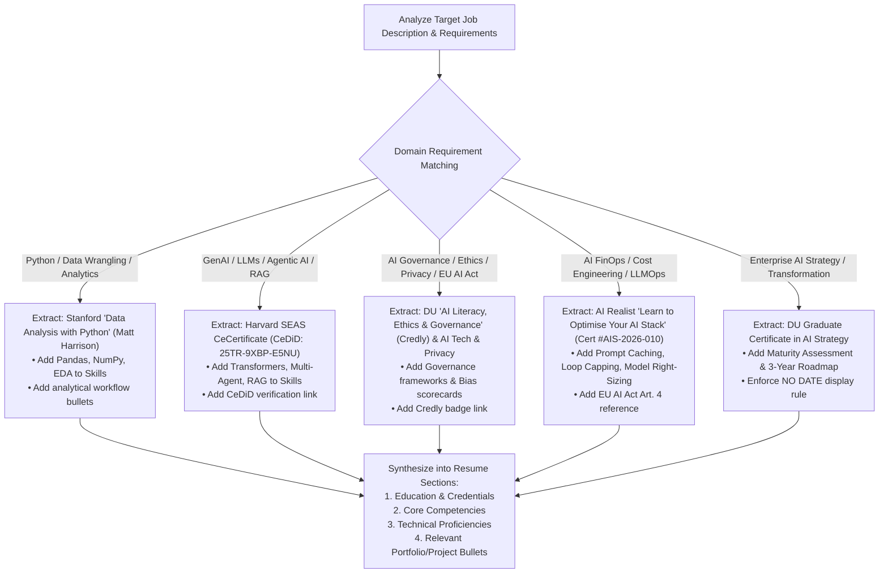

# Candidate Certification & Skill Repository

**Owner:** Ebenezer J. Rolston  
**Contact:** eberolston@yahoo.com • 501-307-3237 • [LinkedIn Profile](https://www.linkedin.com/in/ebenezer-rolston/) • [AI Guardians Portal](https://portal.aiguardiansllc.us/)  
**Last Updated:** 2026-10-12  
**Purpose:** Authoritative repository of verified certifications, professional training, and academic credentials. Used by the Resume Generator, Cover Letter Writer, and Interview Prep agents to dynamically extract job-tailored credentials, tools, competencies, and proof points.

---

## 1. Verified Credentials Catalog

### 1. Data Analysis with Python — Stanford Continuing Studies
* **Issuing Organization:** Stanford Continuing Studies (Stanford University)
* **Recipient:** Ebenezer J Rolston
* **Term / Completion Date:** Fall 2025
* **Instructor:** Matt Harrison (Renowned Python author & data instructor)
* **Credential Signatory:** Jennifer Deitz, Associate Dean and Director
* **Verification:** VeriX QR Code Secure Credential
* **Domains:** Data Analytics, Python Programming, Exploratory Data Analysis (EDA), Data Science
* **Target Roles:** Program Analyst (Data Analytics), Data Analyst, BI Analyst, Data Engineer
* **Verified Skills & Tools:**
  * Python, Pandas, NumPy, Data Cleansing, Data Wrangling, Aggregation & Grouping
  * Statistical Profiling, Exploratory Data Analysis (EDA), Programmatic Data Visualization
* **Extractable Resume Bullets:**
  * *Bullet A:* "Completed Stanford Continuing Studies 'Data Analysis with Python' (taught by Matt Harrison), mastering programmatic data wrangling, exploratory data analysis (EDA), and data manipulation using Pandas and NumPy."
  * *Bullet B:* "Applied advanced Python data structures and Pandas transformations to ingest, sanitize, profile, and aggregate complex multi-variable datasets."
  * *Bullet C:* "Engineered repeatable Python analytical workflows and statistical data visualizations for exploratory trend discovery."
* **Display Format:** `Data Analysis with Python : Stanford Continuing Studies (Taught by Matt Harrison)`

---

### 2. Large Language Models: From Transformer Basics to Agentic AI — Harvard SEAS
* **Issuing Organization:** Harvard John A. Paulson School of Engineering and Applied Sciences (SEAS)
* **Recipient:** Ebenezer J Rolston
* **Date Issued:** October 2025
* **Credential Identifier (CeDiD):** `25TR-9XBP-E5NU`
* **Verification URL:** [Harvard CeCredential Validation](https://cecredential-validation.tlt.harvard.edu/)
* **Signatories:** Pavlos Protopapas (Program Director), Catherine A. Chute (Assistant Dean)
* **Domains:** Generative AI, Large Language Models (LLMs), Agentic AI, Transformers, RAG
* **Target Roles:** AI Strategy Consultant, GenAI Solutions Architect, Agentic AI Engineer, Transformation Lead
* **Verified Skills & Tools:**
  * Transformer Architectures, Multi-Head Self-Attention, LLM Training & Fine-Tuning Principles
  * Retrieval-Augmented Generation (RAG), Prompt Engineering, Agentic Tool Calling, Multi-Agent Workflows
* **Extractable Resume Bullets:**
  * *Bullet A:* "Earned executive credential in 'Large Language Models: From Transformer Basics to Agentic AI' from Harvard SEAS (CeDiD: 25TR-9XBP-E5NU), covering transformer mechanics, attention algorithms, and autonomous agent architectures."
  * *Bullet B:* "Engineered agentic AI workflows integrating tool calling, multi-agent state machines, and dynamic retrieval-augmented generation (RAG) pipelines."
  * *Bullet C:* "Evaluated enterprise LLM architectures against accuracy, hallucination bounds, and workflow integration standards."
* **Display Format:** `Executive Certificate, Large Language Models: From Transformer Basics to Agentic AI : Harvard John A. Paulson School of Engineering and Applied Sciences`
*(Note: CeDiD validation 25TR-9XBP-E5NU stored in repository; omitted from resume face per candidate rule).*

---

### 3. AI Literacy, Ethics, and Governance — University of Denver
* **Issuing Organization:** University of Denver — College of Professional Studies
* **Recipient:** Ebe Rolston
* **Issue Date:** 23 JUN 2026 | **Expiration Date:** 23 JUN 2031
* **Credential Identifier:** `wIjGxM38`
* **Verification URL:** [Credly Badge Validation](https://www.credly.com/go/wIjGxM38)
* **Domains:** AI Governance, AI Ethics, Algorithmic Fairness, Regulatory Compliance, Responsible AI
* **Target Roles:** AI Governance Specialist, AI Ethics & Policy Analyst, Public Sector AI Lead, Strategy Consultant
* **Verified Skills & Tools:**
  * AI Ethics Frameworks, Governance Policies, Algorithmic Bias Mitigation, Transparency & Accountability
  * Organizational AI Literacy, Societal Impact Assessment, Responsible Deployment Safeguards
* **Extractable Resume Bullets:**
  * *Bullet A:* "Earned University of Denver credential in 'AI Literacy, Ethics, and Governance' (Credly verified), establishing frameworks for responsible enterprise AI adoption."
  * *Bullet B:* "Formulated AI ethical risk assessments and governance scorecards addressing algorithmic bias, explainability, and regulatory compliance."
  * *Bullet C:* "Designed enterprise AI literacy modules and organizational readiness criteria to support trustworthy AI transformation."
* **Display Format:** `Credential, AI Literacy, Ethics, and Governance : University of Denver (Credly Verified)`

---

### 4. AI Governance Training — AI, Tech & Privacy Academy
* **Issuing Organization:** AI, Tech & Privacy Academy ([aitechprivacy.com](https://aitechprivacy.com))
* **Recipient:** Ebenezer Rolston
* **Issue Date:** January 30, 2026
* **Instructor / Authority:** Luiza Jarovsky, PhD (CEO & Co-founder)
* **Domains:** AI Governance, Data Privacy, Compliance, Trustworthy AI, Regulatory Risk
* **Target Roles:** AI Governance Analyst, Privacy & Compliance Lead, AI Risk Specialist
* **Verified Skills & Tools:**
  * AI Governance Frameworks, AI Risk Assessment & Scoring, Data Privacy Safeguards
  * EU AI Act & Global Regulatory Alignment, Auditability & Human Oversight Controls
* **Extractable Resume Bullets:**
  * *Bullet A:* "Completed intensive 'AI Governance Training' with AI, Tech & Privacy Academy (under Dr. Luiza Jarovsky), focusing on AI risk mitigation, privacy safeguards, and global regulatory compliance."
  * *Bullet B:* "Structured multi-dimensional AI risk frameworks evaluating data privacy, intellectual property protection, and automated decision-making impact."
* **Display Format:** `AI Governance Training : AI, Tech & Privacy Academy (Dr. Luiza Jarovsky)`

---

### 5. Learn to Optimise Your AI Stack — AI Realist / AI Stack
* **Issuing Organization:** AI Realist / AI Stack (AI Realist OOD, UIC 208702317)
* **Recipient:** Ebenezer Rolston
* **Workshop Date:** 30 July 2026 | **Certificate Issued:** 13 August 2026
* **Certificate Number:** `AIS-2026-010`
* **Instructor:** Maria Sukhareva
* **Verification Contact:** `hello@airealist.org`
* **Regulatory Alignment:** Evidence supporting AI literacy under Article 4 of Regulation (EU) 2024/1689 (EU AI Act), as amended by Regulation (EU) 2026/1744
* **Domains:** AI Cost Optimization, AI FinOps, LLMOps, Prompt Caching, Context Compaction, Agent Loop Capping
* **Target Roles:** AI FinOps Analyst, LLMOps Engineer, AI Solutions Architect, Agentic AI Developer
* **Verified Skills & Tools:**
  * Consumption-Priced AI Billing Analysis & Cost Driver Identification
  * Model Right-Sizing (matching task complexity to lowest-cost capable model)
  * Workload Offloading (shifting deterministic tasks off LLMs into code or skills)
  * Token Cost Reduction via Prompt Caching & Context Compaction
  * Agentic Loop Bounding & Budget Guards (capping loops to eliminate runaway cost)
  * API Gateway vs. Subscription Cost Modeling & Golden-Set Benchmark Evaluation
* **Extractable Resume Bullets:**
  * *Bullet A:* "Completed technical workshop in 'Learn to Optimise Your AI Stack' (AI Realist / Maria Sukhareva, Cert #AIS-2026-010), focusing on LLM cost engineering, prompt caching, and context compaction."
  * *Bullet B:* "Engineered cost-reduction strategies for generative AI pipelines: matched task complexity to right-sized models, capped agentic loops to prevent budget overruns, and offloaded deterministic routines from models into code."
  * *Bullet C:* "Designed golden-set benchmark evaluations to rigorously validate that lower-cost, optimized model pipelines maintained full response fidelity."
  * *Bullet D:* "Analyzed consumption-based AI billing structures, evaluating subscription, API gateway, and model routing trade-offs to maximize enterprise ROI."
* **Display Format:** `Technical Workshop, Learn to Optimise Your AI Stack : AI Realist (Cert #AIS-2026-010)`

---

### 6. Graduate Certificate, AI Strategy & Applications in IT — University of Denver
* **Issuing Organization:** University of Denver
* **Domains:** AI Strategy, Enterprise Transformation, AI Maturity Roadmapping, ROI Modeling
* **Display Rule:** `Graduate Certificate, AI Strategy & Applications in IT : University of Denver` *(Never use "Expected" or graduation dates unless explicitly requested).*

### 7. Professional Program in Machine Learning & Deep Learning — UC Berkeley
* **Issuing Organization:** University of California, Berkeley
* **Domains:** Machine Learning, Deep Learning, Predictive Modeling
* **Display Format:** `Machine Learning : UC Berkeley Extension`

### 8. Academic Degrees — St. Joseph's College
* **Master of Science (M.S.) & Bachelor of Science (B.S.), Computer Science**
* **Display Format:** `M.S. & B.S., Computer Science : St. Joseph's College`

---

### 9. Auditable Multimodal Document Intelligence — TECH 77: Modern AI Architectures
* **Issuing Institution / Course:** TECH 77 — Modern AI Architectures
* **Author / Student:** Ebenezer Rolston
* **Project Format:** Individual Research & Engineering Project
* **Domains:** Multimodal AI, Document Understanding, LangGraph Workflow Orchestration, Prompt-Injection Defense, Auditability
* **Target Roles:** AI Solutions Architect, AI Transformation Lead, Agentic AI Engineer, Technical Product Manager
* **Verified Skills & Architectures:**
  * Vision Language Models (VLMs), Document Transformers (Donut baseline), OCR Baselines (Tesseract)
  * LangGraph StateGraph, Conditional-Edge Graph Execution, Schema & Evidence Gating, Single Bounded Retry
  * Prompt-Injection Detection & Anomaly Gating (treating document text as data, never system instructions)
  * Human-in-the-Loop (HITL) Decision Routing for Accounts Payable and Contract Invoices
* **Extractable Resume Bullets:**
  * *Bullet A (Architectural / Non-Technical):* "Designed an auditable extraction architecture for enterprise invoices and contracts, benchmarking Vision Language Models against Document Transformers and OCR baselines; engineered schema-governed LangGraph controls with evidence-based verification, prompt-injection anomaly gating, and human-in-the-loop decision routing (TECH 77)."
  * *Bullet B (Engineering Focus):* "Engineered multimodal document intelligence pipeline comparing VLM, Donut, and OCR extractors; implemented LangGraph StateGraph conditional routing, enforcing deterministic validation rules, audit logging, and hard-capped single-retry limits for accounts payable processing."
* **Display Format:** `Academic Engineering Project, Auditable Multimodal Document Intelligence : TECH 77 Modern AI Architectures`

---

### 10. ChatGPT Health – Compliance Plan — University of Denver
* **Issuing Organization:** University of Denver — College of Professional Studies
* **Course:** AI Ethics, Policy and Governance
* **Faculty:** Professor Peggy Tsai
* **Author / Student:** Ebenezer Rolston
* **Date Completed:** March 15, 2026
* **Domains:** AI Governance, Healthcare AI Privacy, NIST AI RMF, HIPAA / FTC HBNR, GDPR Article 9, EU AI Act, Risk Management
* **Target Roles:** AI Governance Lead, Privacy & Compliance Partner, AI Risk Specialist, Transformation Lead
* **Verified Frameworks & Controls:**
  * NIST AI RMF (GOVERN function), WHO Health AI Guidance, EU AI Act High-Risk Dual Conformity, FTC Health Breach Notification Rule (HBNR), HIPAA
  * FAIR-Informed Risk Register & ICO Harms Taxonomy (Clinical Hallucinations, Privacy Leakage, Automation Bias, Equity Gaps)
  * Privacy-by-Design Controls: Default non-retention, ephemeral prompt processing in memory, PII/PHI detectors, 30–90-day TTL hashing/redaction, anti-memorization & repeat-word defenses, dynamic health consent gates
  * Human-in-the-Loop (HITL) clinical safety gates and stop-ship escalation procedures
* **Extractable Resume Bullets:**
  * *Bullet A (Governance & Privacy):* "Authored comprehensive AI Compliance Plan for ChatGPT Health (University of Denver), operationalizing NIST AI RMF, GDPR Article 9, FTC Health Breach Notification Rule, and EU AI Act; established privacy-by-design controls including default non-retention, ephemeral prompt processing, PII/PHI leakage defenses, dynamic consent gates, and clinical safety escalation protocols."
  * *Bullet B (Risk Management):* "Structured lifecycle AI risk management program (Identify, Assess, Mitigate, Monitor) mapping clinical hallucinations, PII/PHI leakage, and automation bias to concrete engineering controls, audit trails, and human-in-the-loop clinical review gates."
* **Display Format:** `Graduate Portfolio Project, ChatGPT Health Compliance Plan : University of Denver (Prof. Peggy Tsai)`

---

### 11. OpenAI Codex Bootcamps & Antigravity Agent Engineering Series
* **Issuing Organization:** OpenAI / Codex Developer Community
* **Recipient:** Ebenezer Rolston
* **Date / Series:** 2026 (Completed 7 Intensive Bootcamps across Fundamentals, 201, and 301)
* **Domains:** Autonomous Coding Agents, Multi-Agent Architecture, Model Context Protocol (MCP), Context Engineering, AI Enablement, Prompting Frameworks, AI Governance
* **Target Roles:** AI Enablement Lead, AI Product Manager, AI Solutions Architect, Agentic AI Engineer, Transformation Consultant
* **Verified Skills & Tools:**
  * OpenAI Codex (CLI, IDE Extension, Desktop App), Google Antigravity (AGY CLI, Antigravity IDE, Custom Agents, Skills, Workflows)
  * Plan Mode, `/review`, Parallel Git Worktrees, Automated Build–Test–Fix Loops, Codex Exec
  * Custom TOML & Markdown Agents (Architect, Validator, Auditor, Reviewer, Tester) with Runtime Hooks and Deterministic Rules
  * Model Context Protocol (MCP) Server Architecture & Integration: Figma MCP, GitHub Plugin, Atlassian Plugin, Google Workspace Integration (Drive, Docs, Sheets, Gmail)
  * Context Engineering Standards: `AGENTS.md`, Reusable Skills Lifecycle Management, Weekly Agent Workflow Maintenance
  * Enterprise Prompting Framework: Outcome, Constraints, Scope, Definition of Done, and Programmatic Verification
  * AI Governance: NIST AI RMF 1.0, ISO 42001, Bounded Execution Budgets, Stop Conditions, Human-in-the-Loop (HITL) Gateways, Third-Party Plugin Security Vetting
* **Extractable Resume Bullets:**
  * *Bullet A (Agent Fluency & Prototyping):* "Completed seven OpenAI Codex bootcamps (Fundamentals, 201, 301), mastering CLI, IDE extension, and app workflows, Plan Mode trade-off analysis, parallel Git worktrees, and automated build–test–fix execution loops with regression verification."
  * *Bullet B (Custom Agents & Architecture):* "Engineered specialized TOML and markdown agent definitions (architect, validator, auditor, reviewer, tester) configured with granular runtime hooks, deterministic command permissions, and subagent orchestration."
  * *Bullet C (MCP & Enterprise Tooling):* "Architected Model Context Protocol (MCP) servers and plugins connecting agent environments to Figma, GitHub, Atlassian, and Google Workspace; standardized agent context via AGENTS.md and reusable skill lifecycles."
  * *Bullet D (Enablement & Quality Gates):* "Authored enterprise prompting methodologies (Outcome, Constraints, Scope, Definition of Done, Verification Rules) and evidence-based verification gates replacing agent self-assessment with deterministic testing and diff reviews."
* **Display Format:** `OpenAI Codex Bootcamps (7 Completed: Fundamentals, 201, 301) : OpenAI / Community Track`
* **Guardrails:**
  * Distinguish hands-on bootcamp, personal lab, and company portfolio engineering from commercial client enterprise production deployments.
  * Strictly zero parentheses when extracting into Core Competencies.

---

### 12. Agentic AI for Finance — Packt Certificate Course
* **Issuing Organization:** Packt Publishing
* **Recipient:** Ebenezer Rolston
* **Date / Series:** 2026 (4-Day Intensive Workshop & Masterclass)
* **Instructor:** Nicole Koenigstein (Renowned AI/Quant Researcher, Chief Data Scientist & Author)
* **Domains:** Agentic AI, Harness Engineering, State Machines (FSM/HSM), Multi-Agent Systems (MAS), Trajectory Observability, Reinforcement Learning & Policy Optimization (GRPO/GSPO), OWASP Top 15 Agent Vulnerabilities, Execution Sandboxing, Multimodal Financial RAG, Foundation Time Series
* **Target Roles:** Agentic AI Engineer, AI Solutions Architect, Financial AI Systems Specialist, Quantitative AI Developer, AI Governance & Safety Lead
* **Verified Skills & Tools:**
  * Harness Engineering: 4 Runtime Layers (Identity & Behavior, Runtime, Feedback Loop, Governance & Security), "Model proposes, Harness disposes" architecture, `AGENTS.md` standing directives, loadable `SKILL.md` task specifications
  * State Machine Orchestration: LangGraph StateGraph, Finite State Machines (FSM), Hierarchical State Machines (HSM) with Superstates, Substates, and Parallel Execution Regions
  * Multi-Agent Topologies & Coordination Tax: Hierarchical Supervisor, Peer-to-Peer Negotiation, Blackboard Shared Memory, Swarm Exploration; mitigation of $p^n$ reliability decay via deterministic verification gates and consolidation checkpoints
  * Loop Engineering & Escalation Ladders: 6 core loops (Planning, Reflection, Tool Use, Retrieval, Verification, Human Feedback); structural distinction between reflection (stylistic polish) and verification (objective truth); 4 termination conditions (Success, Budget, No-Progress 2-turn oscillation, Hard Stop); 3-rung escalation ladders (Retry → Re-plan → Human checkpoint)
  * Trajectory Observability & Auditing: Trajectory evaluation ("the path is the deliverable") vs. outcome evaluation; 6 Core Agent Measures (Correctness, Grounding, Latency p95, Cost, Safety, Auditability); OpenTelemetry GenAI semantic conventions, Langfuse (self-hosted for banking data residency), LangSmith; Benchmark contamination defense via SWE-smith programmatic task generation and historical incident replays
  * Reinforcement Learning & Harness Policy Optimization: Harness Learning holding base model weights constant; Group Relative Policy Optimization (GRPO) and Group Sequence Policy Optimization (GSPO) with KL divergence regularization; Relative Universal LLM-Elicited Rewards (RULER); Reward hacking defenses in financial workflows
  * Threat Modeling & Sandboxing: OWASP Top 15 Agent Vulnerabilities mitigation (Principle of Least Privilege PoLP downscoping & Agent Authorization); Docker sandboxing, E2B cloud state sandboxing, Pyodide/Deno in MCP; Zero-Trust UI firewalls (FastAPI/Streamlit); Path traversal symlink resolution; 3-tier fallback validation (Strict JSON Schema Mode → Instructor + Pydantic → Canonicalization)
  * Multimodal Financial Intelligence & Time Series: Non-dataframe financial table extraction (multi-level headers, scale units, parenthetical negatives, footnotes, restatements, footing subtotal reconciliation); Multi-stage chart visual reading (Locate → Read → Interpret); Earnings call audio diarization and hedging qualifier extraction; Foundation time-series models (Chronos, TimesFM, PatchTST, AnomalyBERT) as calibrated quantile distribution tool calls; LLM serving physics (vLLM PagedAttention, SGLang RadixAttention KV cache reuse)
* **Extractable Resume Bullets:**
  * *Bullet A (Harness Engineering & State Machines):* "Architected enterprise agentic workflows using LangGraph StateGraph, deploying Finite and Hierarchical State Machines (FSM/HSM) with 4-layer harness isolation separating non-deterministic model proposals from deterministic policy enforcement and sandbox bounds."
  * *Bullet B (Multi-Agent Systems & Loop Governance):* "Engineered multi-agent collaboration topologies (hierarchical supervisor, peer-to-peer, blackboard, swarm) with bounded loop controls, 4 mandatory termination conditions, and a 3-rung escalation ladder to eliminate infinite loops and mitigate multi-agent coordination tax."
  * *Bullet C (Trajectory Observability & Auditing):* "Instrumented end-to-end trajectory observability using OpenTelemetry and self-hosted Langfuse, evaluating multi-step reasoning traces across 6 dimensions (Correctness, Grounding, Latency p95, Cost, Safety, Auditability) and preventing benchmark contamination through programmatic SWE-smith task generation."
  * *Bullet D (Multimodal Financial Intelligence & Time Series):* "Designed multimodal financial intelligence pipelines parsing non-dataframe SEC filing tables with footing reconciliation, extracting audio earnings call guidance via speaker diarization, and integrating foundation time-series models (TimesFM, Chronos) as calibrated quantile distribution tool calls."
* **Display Format:** `Agentic AI for Finance : Packt Certificate Course (Nicole Koenigstein)`
* **Guardrails:**
  * Distinguish intensive masterclass and lab implementations from commercial banking production deployments.
  * Strictly zero parentheses when extracting into Core Competencies.
  * Omit completion dates from resume face per candidate rule.

---

## 2. Dynamic Extraction Rules for Resume Generator

When generating or updating a tailored resume, cover letter, or interview package, the **Resume Generator** MUST apply the following extraction logic:

### Specific Section Placement Rules:
1. **EDUCATION & CREDENTIALS:**
   - Always place academic degrees and top job-relevant credentials in this section.
   - For technical data roles, prominently feature the Stanford Python credential.
   - For GenAI/Agentic roles, feature Harvard SEAS with CeDiD.
   - For governance/policy roles, feature DU Credly credential and AI Tech & Privacy Academy.
   - Enforce standing guardrail: University of Denver Graduate Certificate must never have a date attached.

2. **CORE COMPETENCIES & TECHNICAL PROFICIENCIES:**
   - Extract verified tools directly from the matched certificates:
     * *Data roles:* Add `Python (Pandas, NumPy)`, `Exploratory Data Analysis (EDA)`.
     * *AI cost/FinOps roles:* Add `Prompt Caching`, `Context Compaction`, `Agentic Loop Bounding`, `Model Right-Sizing`.
     * *Agentic AI roles:* Add `Agentic AI Workflows`, `Multi-Agent Routing`, `RAG`.
     * *Governance roles:* Add `AI Governance Frameworks`, `Algorithmic Bias Mitigation`, `EU AI Act Compliance`.

3. **PORTFOLIO / SABBATICAL PROJECTS:**
   - Use pre-drafted extractable bullets when creating project callouts or describing career sabbatical upskilling accomplishments.

4. **STRICT EVIDENCE-GROUNDING & PROHIBITION ON SKILL INVENTION (GENERAL CANDIDATE RULE):**
   - The Resume Generator must NEVER invent, extrapolate, or hallucinate skills, regulatory frameworks, tools, or domain credentials simply because they appear in a target job description.
   - All claims must be grounded in verified certifications in this repository, documented career history in `master_resume.md`, or explicit answers provided during candidate fact-finding sessions.
   - Unverified target job requirements (e.g., MDR/IVDR, ISO 13485, FDA 510(k)) must NEVER be placed on the face of the resume; they must be treated strictly as gaps to be bridged in `Skill_Gap_Analysis.md`.

---

## 3. How to Add Future Certificates to This Repository

To add future certificates:
1. **Add JSON entry:** Open `data/certifications_repository.json` and append a new certificate object following the standard schema.
2. **Add Markdown entry:** Append a new numbered entry in `data/certifications_repository.md` with:
   - Official credential name and institution
   - Date, expiration, and ID/verification link
   - Primary domains and matching target roles
   - Specific verified skills/tools
   - 2–3 extractable, accomplishment-focused resume bullets
3. **Tagging:** Ensure at least 2 domain tags match prospective job keywords to enable instant extraction during automated resume runs.
